# patent-style-lora

**Turn any gadget into a US patent drawing.** A small LoRA adapter for Stable Diffusion XL, trained on 24 public-domain
US design-patent figures. Add the trigger word `ptnt_style` to a prompt and SDXL draws the object the way a patent
does: black lines on a pure white page, line-based shading, one centered figure.

| | |
| --- | --- |
| **Model** | [huggingface.co/Jatin1999/patent-style-lora](https://huggingface.co/Jatin1999/patent-style-lora) (59.5 MB) |
| **Trigger** | `ptnt_style, <view> of <object>`, e.g. `ptnt_style, perspective view of a quadcopter drone` |
| **Strength** | 0.7 |
| **Base model** | SDXL base 1.0 |
| **Demo** | "Patent My Idea" Gradio app in [`demo/`](demo/), going live as a Hugging Face Space |

## Objective

Learn how diffusion fine-tuning works end to end by training a style LoRA, and answer one question honestly:
**does a 24-image LoRA beat a well-written prompt?** SDXL can already be asked for "a patent drawing", so a LoRA is
only worth it if it measurably improves on that baseline, on objects it never saw in training.

## Approach

```mermaid
flowchart LR
    A[DeepPatent<br/>3,000 drawing sheets] --> B[Pre-screen:<br/>1,732 single-figure sheets]
    B --> C[Hand-pick 24<br/>varied objects + views]
    C --> D[Clean: strip labels,<br/>center, pad to 1024px]
    D --> E[Caption: trigger +<br/>view + object]
    E --> F[Train LoRA<br/>Colab L4]
    F --> G[Pick checkpoint<br/>from a fixed-seed grid]
    G --> H[Evaluate vs.<br/>prompt-only baseline]
    H --> I[Publish to<br/>Hugging Face]
```



- **Data.** US patent drawings are generally not subject to copyright, so the dataset is legally clean. Drawings come
  from the DeepPatent dataset (US design patents). A script isolates the main figure, removes "FIG. 1" labels and
  sheet numbers, and pads each figure onto a white 1024×1024 square.
- **Captions** describe only the object and the view (`ptnt_style, side view of a car wheel rim`), never the style,
  so the trigger word has to carry the style on its own.
- **Training** uses the Hugging Face Diffusers SDXL LoRA script on a single NVIDIA L4 in Google Colab, with
  checkpoints saved to Google Drive so runs survive disconnects.
- **Evaluation** is fixed before training: 10 subjects (4 object types like the training set, 6 unseen gadgets) × 3
  seeds, identical sampler, steps, CFG and negative prompt across four conditions: base prompt, prompt-only
  ("patent drawing … black and white line art"), LoRA at 0.4 / 0.7 / 1.0, and LoRA plus style words.

## What we did

1. **Dataset.** Downloaded 3,000 drawing sheets, automatically pre-screened them to 1,732 that look like one clean
   figure, and hand-picked 24 for variety: electronics (smartwatch, security camera, solar panel, heat-sink module),
   kitchenware, tools, mechanical parts, a car wheel, apparel and footwear. A first pick of 25 consecutive patents was
   mostly clothing, which would have taught "patent drawings of garments" instead of a style; 8 of them were kept and
   the rest replaced with varied objects. BLIP's draft captions were mostly wrong on line art ("a book", "a beer keg"),
   so every caption was rewritten by hand.
2. **Baselines first.** Rendered the no-LoRA conditions before training, so training couldn't be tuned toward the test.
3. **Run 01** (rank 16, LR 1e-4, 1,500 steps, UNet only): partial. Two of four probe prompts became centered line
   drawings only in the last checkpoints, still on peach and pink backgrounds; the desk lamp stayed a photo. Raising the
   LoRA strength added hatching texture but never produced a white page.
4. **Diagnosis.** Three separate problems: undertrained, a weakly bound trigger word (only the UNet was trained), and
   the drift toward mid-tones that diffusion models show when asked for mostly-white images.
5. **Run 02** (+ noise offset 0.1, + text-encoder training, 3,000 steps): worked from the first checkpoint. Checkpoints
   after about 2,000 steps overfit, so **checkpoint 1,500** was chosen from the comparison grid.
6. **Full evaluation**, then published the LoRA with a model card on Hugging Face.

## Results (run 02, checkpoint 1,500)

Means per condition over 3 seeds. "Unseen" = drone, smartwatch, VR headset, electric scooter, robot arm, foldable phone.

| Condition | Subjects | White border ↑ | Gray share ↓ | Color leak ↓ | CLIP subject ↑ | Sim. to training set |
| --- | --- | --- | --- | --- | --- | --- |
| A: base prompt, no LoRA | unseen | 0.001 | 0.746 | 0.719 | 0.284 | 0.474 |
| B: "patent drawing … line art", no LoRA | unseen | 0.440 | 0.241 | 0.000 | 0.301 | 0.601 |
| **C: LoRA @ 0.7** | **unseen** | **0.998** | **0.038** | **0.000** | **0.316** | 0.678 |
| C: LoRA @ 1.0 | unseen | 0.999 | 0.027 | 0.000 | 0.308 | 0.696 |
| B: prompt only | seen-type | 0.151 | 0.186 | 0.049 | 0.302 | 0.507 |
| **C: LoRA @ 0.7** | **seen-type** | **0.999** | **0.023** | **0.000** | **0.315** | 0.693 |

*White border* = share of near-white pixels around the edge (a patent figure sits on a white page). *Gray share* =
share of mid-gray pixels (line art is mostly pure black or white). *CLIP subject* = how well the image still matches the
plain object name, i.e. whether the drone is still a drone.

## What we achieved

- **The LoRA beats prompting on what makes a patent drawing.** Against the best plain prompt, the page goes from beige
  "old paper" to white (border 0.44 → 0.998 on unseen objects) and muddy gray shading drops 6–8×.
- **Without losing the subject.** The CLIP subject score holds and slightly improves (0.301 → 0.316).
- **It generalizes.** Gadgets that were never in the training set score the same as the trained object types.
- **The trigger carries the style by itself.** Adding style words on top of `ptnt_style` changes almost nothing.
- **It picked up a real patent convention** without being told: dashed lines for parts that aren't claimed.
- A small, shareable result: a 59.5 MB adapter trained on 24 images in under two hours on one L4.

## Lessons learned

- **Measure against a strong baseline.** SDXL already draws decent line art when prompted; the LoRA's value turned out
  to be the page (white, one centered figure, no fake text), which only the baseline comparison revealed.
- **A white background is a training problem, not a prompt problem.** Noise offset was the single change that took
  backgrounds from peach to white.
- **Train the text encoder when the trigger is a made-up word.** UNet-only training left the desk lamp untouched at
  any strength; with text-encoder training it switched at step 500.
- **Save checkpoints and look at them.** The last checkpoint was not the best: by step 3,000 the quadcopter had six arms.
- **Dataset variety matters more than size.** With only 24 images, a batch dominated by one category (clothing) would
  have taught the category instead of the style.
- **Notebook plumbing breaks in boring ways.** Fixed along the way: an old `torchao` in Colab breaking PEFT, the
  `image-to-text` pipeline removed in transformers 5, a file named `checkpoint_*` derailing resume, and Google Drive
  disconnecting mid-session.

## Limitations

- Automated metrics on 30 images per condition are proxies. They don't catch fake text, extra objects or mechanically
  impossible parts; the grids need a human look.
- Similarity to the training set rises (0.60 → 0.68), consistent with learning a style, but this is not a full
  memorization test.
- Generated figures are illustrations, not valid patent drawings, and carry no legal meaning.
- One base model, one dataset, one rank. Results may not transfer to SDXL derivatives without retesting.

## Next steps

- Launch the "Patent My Idea" demo as a Hugging Face ZeroGPU Space.
- Commit the 24-image dataset, captions and manifest to this repo.
- Add a comparison image (prompt-only vs. LoRA) to this README.
- Try rank 8 vs. 32 and fewer training images to find the smallest LoRA that still works.

Full run-by-run notes: [`notes/learning-log.md`](notes/learning-log.md). Training configs: [`configs/`](configs/).

## Reproduce it

### Run it entirely in Google Colab

**One-time setup (2 minutes):** in Google Drive, create a folder named `patent-lora` in My Drive and upload
`patent-drawing-lora.zip` into it. Every notebook unpacks it to `MyDrive/patent-lora/repo` on first run and works
from there, so your picks, captions, checkpoints and results all stay on Drive.

Open each notebook in Colab with **File → Upload notebook** (or open it from `MyDrive/patent-lora/repo/notebooks/`).

| # | Notebook | Runtime | What you do | Time |
| --- | --- | --- | --- | --- |
| 1 | `01_dataset_colab.ipynb` | **CPU** | download sheets, tick ~25 in the picker, clean, review, fix captions | 1.5-3 hrs (mostly picking) |
| 2 | `03_eval_colab.ipynb`, *Baselines* section only | **L4** | render the no-LoRA baselines before training | 15 min |
| 3 | `02_train_colab.ipynb` | **L4** | train, then compare checkpoints and pick one | 1-2 hrs |
| 4 | `03_eval_colab.ipynb`, rest | **L4** | full eval with your checkpoint, publish to the Hub | 40 min |
| 5 | `demo/` | Hugging Face Space | upload `app.py`, `requirements.txt`, `SPACE_README.md` (as `README.md`) to a ZeroGPU Space | 20 min |

#### Using the Colab extension in VS Code

The notebooks also run from VS Code with Google's Colab extension:

1. Open this project folder in VS Code and open a notebook from `notebooks/`.
2. **Select Kernel → Colab → New Colab Server**, and choose the machine type (CPU for notebook 01, L4 for 02 and 03).
3. Run the cells as usual. Drive mounting and the picker/caption widgets work. The code runs on Colab's machine,
   not your laptop, so the project still has to be on Drive (the zip in `MyDrive/patent-lora/`).

Differences from the browser: the Hugging Face upload cell asks you to paste your token instead of reading
Colab Secrets, and if the last "disconnect" cell can't stop the runtime, use **Command Palette → Colab: Remove Server**.

Expect roughly 5-8 compute units for one full run. Each GPU notebook ends with a cell that disconnects
the runtime; run it so an idle GPU doesn't keep using units.

### Optional: run the data steps on a laptop instead

| Step | Command |
| --- | --- |
| Fetch candidates | `python scripts/fetch_candidates.py --shards 0 120 240` (contact sheets in `dataset/candidates/sheets/`) |
| Pick | list file stems in `dataset/selection.txt` |
| Clean | `python scripts/prepare_data.py` |
| Draft captions | `python scripts/caption.py draft`, then edit `dataset/captions.csv` |
| Build metadata | `python scripts/caption.py build` |

Then copy the project folder to `MyDrive/patent-lora/repo` and continue with the training notebook.

#### Laptop setup (Windows)

```powershell
cd patent-drawing-lora
python -m venv .venv
.venv\Scripts\activate
pip install -r requirements-local.txt
# Only if you want GPU on the RTX 5060 (Blackwell needs CUDA 12.8+ builds):
pip install torch torchvision --index-url https://download.pytorch.org/whl/cu128
python -c "import torch; print(torch.cuda.is_available(), torch.cuda.get_device_name(0) if torch.cuda.is_available() else '')"
pytest -q   # data-prep and metric tests, CPU only
```

### Picking images

In the picker (or the contact sheets on a laptop), pick drawings that are:

- one clear object per sheet (multi-figure sheets get the largest figure kept, but check)
- varied: tools, electronics, furniture, kitchenware, wearables, vehicles; at most 2 per category
- a mix of views (about half perspective) and shading styles (hatching, stippling, plain outline)

Pick ~25 so you can drop the ones that clean up badly. Picks are stored in `dataset/selection.txt`.

After cleaning, review every image (notebook 01, step 4). Remove any that still show labels,
lost parts of the object, or were flagged as possibly having a second figure.

**Rights check:** open each patent's `source_url` from `dataset/manifest.csv` and confirm the text has
no copyright notice (37 CFR 1.71(d)); then write `no notice` in `copyright_notice_checked`.

### Captions

The caption editor (notebook 01, step 7) stores one row per image in `captions.csv`: `object` (e.g. `a cordless power drill`) and `view`
(perspective / front / side / top / rear / bottom / exploded view). Describe the object and the view only.
Never add style words such as "line art" or "black and white": the trigger word must carry the style.

Saving produces lines like `ptnt_style, side view of a cordless power drill` in `dataset/images/metadata.jsonl`.

## Repo layout

```
configs/train_sdxl.yaml       every training hyperparameter (copied next to each run's checkpoints)
dataset/selection.txt         your hand-picked sheet IDs
dataset/images/               24 cleaned 1024px PNGs + metadata.jsonl (on Drive; to be committed)
dataset/manifest.csv          patent number, date, sheet, source URL, rights check
dataset/captions.csv          editable captions (object + view)
scripts/fetch_candidates.py   download DeepPatent shards + contact sheets
scripts/prepare_data.py       isolate main figure, strip labels, pad, resize
scripts/caption.py            BLIP draft captions -> metadata.jsonl
scripts/eval.py               fixed-seed eval: 4 conditions, grids, scores
scripts/pixel_metrics.py      color leakage, border whiteness, gray share
scripts/colab_ui.py           notebook widgets: picker, review, caption editor
notebooks/01_dataset_colab.ipynb build the dataset in Colab (CPU runtime)
notebooks/02_train_colab.ipynb   training on a Colab L4, resumable from Drive
notebooks/03_eval_colab.ipynb    baselines, full eval, Hub upload
demo/                         Gradio app for a ZeroGPU Space + model card
tests/                        CPU tests for data prep and metrics
```

## Credits

Drawings from US design patents via [DeepPatent](https://openaccess.thecvf.com/content/WACV2022/html/Kucer_DeepPatent_Large_Scale_Patent_Drawing_Recognition_and_Retrieval_WACV_2022_paper.html)
(Kucer et al., WACV 2022). Training uses the Hugging Face Diffusers SDXL LoRA example script.
