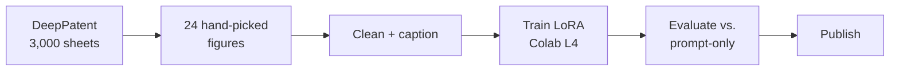

# patent-style-lora

SDXL LoRA that turns any object into a US patent-style drawing: black lines, white page, one centered figure.

| | |
| --- | --- |
| Model | [huggingface.co/Jatin1999/patent-style-lora](https://huggingface.co/Jatin1999/patent-style-lora) (59.5 MB) |
| Prompt | `ptnt_style, <view> of <object>` |
| Strength | 0.7 |
| Base | SDXL base 1.0 |

## Usage

```python
import torch
from diffusers import StableDiffusionXLPipeline

pipe = StableDiffusionXLPipeline.from_pretrained(
    "stabilityai/stable-diffusion-xl-base-1.0", torch_dtype=torch.float16).to("cuda")
pipe.load_lora_weights("Jatin1999/patent-style-lora", adapter_name="patent")
pipe.set_adapters(["patent"], adapter_weights=[0.7])

image = pipe("ptnt_style, perspective view of a quadcopter drone",
             negative_prompt="color, gray background, photo, 3D render, text").images[0]
image.save("drone.png")
```

Needs a GPU with ~10 GB of VRAM (or `pipe.enable_model_cpu_offload()` instead of `.to("cuda")` on 8 GB).

## Objective

Train a style LoRA on 24 images and test whether it beats a well-written prompt ("patent drawing, black and white line art").

## Approach



- **Data:** 24 public-domain US design-patent figures (DeepPatent), labels removed, padded to 1024×1024. In [`dataset/`](dataset/), with sources in [`manifest.csv`](dataset/manifest.csv).
- **Captions:** trigger + view + object only, no style words.
- **Training:** Diffusers SDXL LoRA script, rank 16, LR 1e-4, noise offset 0.1, UNet + text encoders, checkpoint 1,500 of 3,000.
- **Eval:** 10 subjects (6 unseen) × 3 seeds, fixed settings across all conditions.

## Results

Unseen objects (drone, smartwatch, VR headset, scooter, robot arm, foldable phone):

| Condition | White border ↑ | Gray share ↓ | CLIP subject ↑ |
| --- | --- | --- | --- |
| No LoRA, plain prompt | 0.001 | 0.746 | 0.284 |
| No LoRA, "patent drawing … line art" | 0.440 | 0.241 | 0.301 |
| **LoRA @ 0.7** | **0.998** | **0.038** | **0.316** |
| LoRA @ 1.0 | 0.999 | 0.027 | 0.308 |

*White border:* share of near-white pixels at the image edge. *Gray share:* share of mid-gray pixels (line art is mostly pure black or white). *CLIP subject:* similarity to the plain object name, i.e. whether the drone is still a drone.

- White page instead of beige paper; 6× less gray shading; subject preserved.
- Same results on unseen objects as on trained object types.
- Run 1 (UNet only, 1,500 steps) failed: colored backgrounds, weak trigger. Run 2 added noise offset, text-encoder training and more steps, which resolved both.
- Checkpoints after ~2,000 steps overfit.

Details: [`notes/learning-log.md`](notes/learning-log.md)

## Limitations

- Metrics don't catch fake text, extra objects or impossible parts.
- Outputs are illustrations, not valid patent drawings.

## Reproduce

1. Open the notebooks in Colab (File → Upload notebook). The first cell clones this repo into `MyDrive/patent-lora/repo`; everything is saved there.
2. Run in order:

| Notebook | Runtime | Purpose |
| --- | --- | --- |
| `01_dataset_colab.ipynb` | CPU | download, pick, clean, caption |
| `02_train_colab.ipynb` | L4 | train, compare checkpoints |
| `03_eval_colab.ipynb` | L4 | baselines, eval, publish |

3. Demo: upload `demo/app.py`, `demo/requirements.txt`, `demo/SPACE_README.md` (as `README.md`) to a Hugging Face ZeroGPU Space (free for accounts 30+ days old).

## Repo

```
configs/     training configs per run
dataset/     the 24 training images, captions, manifest (patent numbers + sources)
eval/        fixed eval prompts and seeds
scripts/     data prep, captions, eval, metrics, Colab widgets
notebooks/   Colab notebooks 01-03
demo/        Gradio app + model card
notes/       run-by-run log
tests/       CPU tests (pytest)
```

## Credits

Drawings from US design patents via [DeepPatent](https://openaccess.thecvf.com/content/WACV2022/html/Kucer_DeepPatent_Large_Scale_Patent_Drawing_Recognition_and_Retrieval_WACV_2022_paper.html) (Kucer et al., WACV 2022). Training uses the Hugging Face Diffusers SDXL LoRA script.
